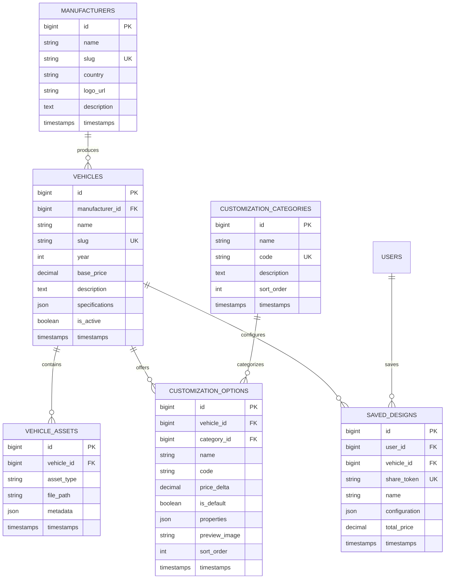

# AutoStudio — Database Schema Documentation

## Entity Relationship Overview

The AutoStudio database is designed to support multi-manufacturer, multi-model vehicle cataloging, realistic 3D asset metadata, and granular customization options (paints, wheels, brake calipers, interiors), as well as persisted user configurations.

## Tables & Fields Specification

### 1. `manufacturers`
- `id` (Primary Key)
- `name` (e.g. `Porsche`, `Mercedes-Benz`)
- `slug` (Unique identifier, e.g. `porsche`)
- `country` (Country of origin)
- `logo_url` (Path or URL to vector logo)
- `description` (Brand summary)

### 2. `vehicles`
- `id` (Primary Key)
- `manufacturer_id` (Foreign Key to `manufacturers.id`, cascade on delete)
- `name` (e.g. `911 Carrera`)
- `slug` (Unique identifier, e.g. `porsche-911-carrera`)
- `year` (Model year, e.g. `2026`)
- `base_price` (Base MSRP in USD)
- `description` (Vehicle overview)
- `specifications` (JSON structure: horsepower, torque, 0-60 mph, top speed, engine, drivetrain, transmission)
- `is_active` (Visibility toggle in public catalogue)

### 3. `vehicle_assets`
- `id` (Primary Key)
- `vehicle_id` (Foreign Key to `vehicles.id`, cascade on delete)
- `asset_type` (`model_glb`, `thumbnail`, `badge`, `sound`)
- `file_path` (Path to asset in storage or static web root)
- `metadata` (JSON: GLTF node selectors for car body, wheels, calipers; camera default positions and targets)

### 4. `customization_categories`
- `id` (Primary Key)
- `name` (e.g. `Exterior Paint`, `Wheel Design`, `Brake Calipers`)
- `code` (Unique slug: `paint`, `wheels`, `calipers`)
- `description` (Guidance notes for the customization step)
- `sort_order` (Display ordering in configurator sidebar)

### 5. `customization_options`
- `id` (Primary Key)
- `vehicle_id` (Foreign Key to `vehicles.id`, cascade on delete)
- `category_id` (Foreign Key to `customization_categories.id`)
- `name` (e.g. `Gentian Blue Metallic`, `20/21-inch Carrera S Wheels`)
- `code` (Unique per vehicle: `paint_gentian_blue`, `wheel_carrera_s`)
- `price_delta` (Price adjustment above base vehicle price)
- `is_default` (Whether this option is selected by default)
- `properties` (JSON: for paint: `{ hex, finish, roughness, metallic, clearcoat, clearcoatRoughness }`; for wheels: `{ style, color_hex, finish, spoke_count }`)
- `preview_image` (Optional swatch or thumbnail icon)
- `sort_order` (Display order within category)

### 6. `saved_designs`
- `id` (Primary Key)
- `user_id` (Nullable Foreign Key to `users.id` for logged-in or guest users)
- `vehicle_id` (Foreign Key to `vehicles.id`)
- `share_token` (Unique random string for sharing and retrieval, e.g. `aB9xKl2p0wQr`)
- `name` (User-defined configuration title)
- `configuration` (JSON representation of chosen options and pricing breakdown)
- `total_price` (Computed final configured price)
